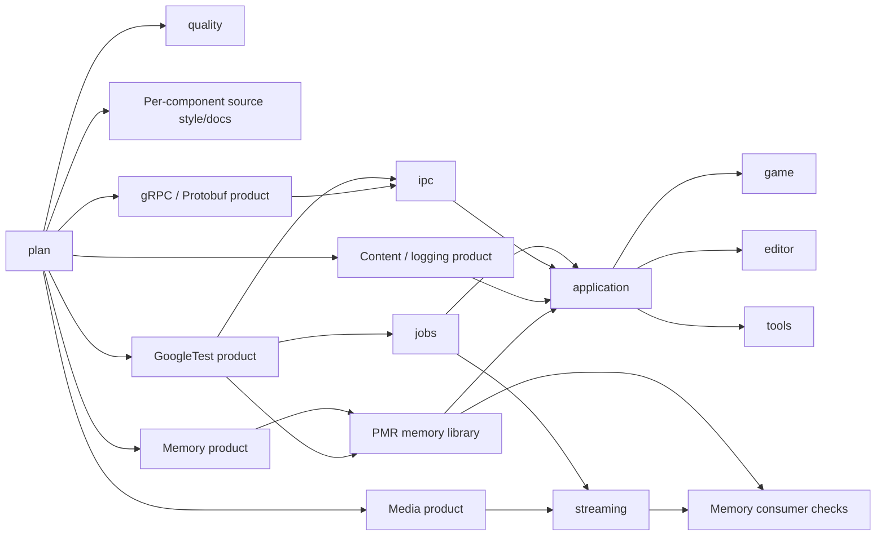

# Continuous integration and delivery

## Independent component pipelines

PRs and main/tag delivery share `reusable_validation.yml`. It starts independent
formatting/documentation checks, repository quality checks,
six dependency-product producers and independently named component pipelines.
There is no global dependency-preparation or quality barrier before native builds.
Each component waits only for its own external groups and compiled Atlas prerequisites.

Pull requests also require independent Doxygen reference generation, without wiki
credentials. The separate `documentation.yml` workflow generates and publishes
the API wiki on `main`, independently of package/release jobs. Its reusable build,
temporary transfer artifact, synchronization policy and retry procedure are
described in [API reference and wiki](27_api_reference_and_wiki.md).

The diagram highlights the independent paths; the declarative workflow also wires
testing/content/media integration and Windows SDK checks. All jobs currently run
on Windows. Runner concurrency limits can still queue runnable work. A component's
profile matrix finishes before its downstream component pipeline starts; profiles
within each matrix run independently. This removes the global gRPC barrier without
claiming unlimited runner capacity or a completely asynchronous scheduling graph.

| File | Responsibility |
| --- | --- |
| `pr.yml` | PR entry point and stable required `PR validation` status |
| `delivery.yml` | Main validation/packaging and strict version-tag publishing |
| `reusable_plan.yml` | Change impact, formatting contexts, component prerequisites and vendor identities |
| `reusable_validation.yml` | Explicit component/vendor dependency graph and final gate |
| `reusable_quality.yml` | Global assets, repository/tooling checks, analyzer configuration and workflow lint |
| `reusable_format.yml` | Independent pinned C++/Python/Protobuf formatting and source-documentation checks per context |
| `reusable_dependencies.yml` | Recover or prepare one compiled third-party product |
| `reusable_build.yml` | Build/test/export exactly one component per profile |
| `reusable_package.yml` | Assemble validated Release applications; no compilation |
| `setup_ci` / `restore_inputs` actions | Shared tooling and exact compiled-input recovery |

Actions are pinned to commit SHAs. Validation tokens have `contents: read` and
`actions: read`; only tagged publishing receives `contents: write`. PRs use
`pull_request`, never a privileged PR trigger. Keep `PR validation` required in
branch protection; CODEOWNERS alone does not enable protection or approvals.

## Change impact and build contracts

`.ci/components.yaml` declares paths, change-consumer edges (`depends_on`), real
compiled prerequisites (`build_requires`), vendor groups, targets and CTest labels.
The planner selects changed components and transitive consumers, then includes
the libraries needed to link them. Editor-only changes do not select atlas_game.
Required shared libraries still need producer jobs to provide link inputs.

Formatting selects direct source owners independently of build-consumer expansion.
Shared formatter-policy changes recheck every populated formatting context; an
unmapped owned source fails planning. See the [source style contract](26_source_style_and_documentation.md)
for CLI/IDE commands, reference comments and required-gate behavior.

Documentation-only changes start no native compilation. Shared build/tool changes
are conservatively global. Unmapped C++/Protobuf sources fail planning. Contexts
with no implemented targets produce no pretend builds. `windows-portable` omits
the Windows component and disables native SDK integration. Zero discovered tests
is an error. Every component gets Debug, Release, ASan, analysis, clang-tidy and
coverage checks, plus the portable profile where applicable.

CMake's `ATLAS_COMPONENTS` configures only the requested component and its actual
prerequisites. Only requested components register tests. The CI runner imports
prerequisites from `ATLAS_PREBUILT_ROOT`; missing products fail instead of silently
rebuilding their sources. Local full builds remain the default when no component
selection is specified. Update both the CMake prerequisite declarations and the
CI mapping when adding a real library/application; regression tests compare them.

## Compiled dependency products

`.ci/dependencies.yaml` partitions the pinned vcpkg manifest:

| Product | Direct packages | Consumers |
| --- | --- | --- |
| testing | GoogleTest | Library and native integration tests |
| content | EnTT, pugixml, yaml-cpp, spdlog | Dependency tests and application logging |
| media | dav1d, libwebm, Opus | Streamer media tests and dependency tests |
| ipc | gRPC, Protobuf | Protocol and application consumers |
| graphics | DirectX Shader Compiler | Windows SDK integration tests |

A product contains installed Debug/Release libraries, runtime DLLs, headers,
code-generation tools, CMake metadata, notices and the pinned vcpkg CMake helpers.
It is named `vendor-<group>-<identity>` and retained for **14 days**. This is Actions
storage, not a release or public package feed; access follows repository/Actions
visibility and is not a separate private storage service.
See GitHub's [artifact storage documentation](https://docs.github.com/en/actions/tutorials/store-and-share-data)
and [download access rules](https://docs.github.com/en/actions/how-tos/manage-workflow-runs/download-workflow-artifacts).

The identity covers the selected manifest entries, registry baseline/configuration,
applicable overlay patches, artifact schema, MSVC toolset, Windows SDK, LLVM and
triplet. Unchanged versions can still require new binaries after a toolchain or ABI
policy change. Bump the schema/identity policy when changing producer build flags.
Application source changes do not invalidate vendor products.

Each producer looks up an exact, unexpired product from a successful producer job
in a **main push** of `delivery.yml` in this repository. It never trusts products
from another PR/fork. A main producer can be reused while unrelated validation is
still running. Lookup paginates artifacts; unavailable/expired products are rebuilt
only for that group. Cross-run downloads use the read-only workflow token and run ID.
A hit is consumed directly from its source run, without uploading another large copy.

### Cold-build cost and cache recovery

Cold gRPC compilation remains expensive: the observed first successful hosted run
spent approximately 54 minutes on gRPC, 12 on Protobuf and 5 on OpenSSL. Artifact
reuse avoids repeating that work while compatible products remain available.
Jobs, streaming and native checks can proceed while a cold IPC group is compiling.
No fixed end-to-end speedup is claimed before measuring the new hosted workflow.

Producer jobs have 140 minutes, with a 110-minute install-step limit and time left
for saving diagnostics/partial binary archives. Output includes native-build
heartbeats. Binary archives are a secondary recovery layer for cold/expired
products; vcpkg checks their package ABI. Hard cancellation may prevent final saves.

Consumers compose only their required installed products, rejecting conflicting
files and using hard links where supported. The bundled toolchain selects the
correct Debug/Release imports; **`VCPKG_MANIFEST_INSTALL=OFF`** prevents package
installation or source compilation in component jobs. Temporary composed trees
live through configuration, compilation, tests and export, then are cleaned up.

## Atlas products inside a run

Library producers export relocatable CMake targets, archives and public/generated
headers. Consumers import these targets instead of recompiling prerequisites.
Owned artifact names include component, profile, configuration and revision;
downloads use the current workflow run, and provenance records verify all of these
fields plus the run ID. Debug/Release, sanitizer and compiler-profile products never
mix. Source products are retained for one day and are not looked up across runs.
If these short-lived products expire, rerun the full validation rather than only
a downstream failed job, so its producers generate fresh same-run link inputs.

Each component retains its own coverage report. Reports contain fresh profiles
and may include exercised imported library code. Formatting is global, not repeated
as a separate badge per component. Coverage and ASan do not establish race freedom;
vendor binaries retain their normal non-ASan ABI. Native Windows TSan is unavailable.

## Assets and delivery

Assets require `assets/manifest.xml` when files exist. Validation checks XML syntax,
unique IDs/paths, mapped existing files, containment and declared dependencies.
DTD/entity declarations are rejected. Empty assets need no invented inventory.
Full UI/ViewModel schemas remain future work.

PRs validate and export internal build products; they do not create deliverable
packages or publish. Main pushes run full validation and assemble the four already
compiled **MSVC Release** applications, runtime DLLs, docs, an XML version manifest
and notices. Duplicate package paths must have identical contents. Packaging
verifies run/revision/configuration provenance and creates ZIP/SHA256 artifacts
without another native build. The applications remain headless bootstrap programs.

Only `vMAJOR.MINOR.PATCH` or `VMAJOR.MINOR.PATCH` tags qualify for publishing; no
leading zeros, suffixes or partial versions. The gate peels annotated tags, verifies
the checkout and membership in `origin/main` history, and rejects side-branch tags.
The tag run validates its exact commit and packages its own Release products.
Publishing downloads that run's package and uses `gh release create --verify-tag`;
it does not create tags or overwrite releases. Standard SemVer applies.

Local CMake/pytest/actionlint checks cannot prove artifact-service permissions,
retention settings, hosted concurrency or hosted timing. Verify those in the first
run after this workflow revision is pushed. No hosted performance result is implied
by editing these workflow definitions.

## Job contract instrumentation

`atlas::jobs` exports its job-sanitizer configuration to linked consumers.
The default AUTO mode enables live declared-access checking in all Debug component
profiles, including imported same-run jobs products; Release disables that tracking.
No source scan or IDE plugin is required. Tests execute the instrumented runtime.
Ranges declare chunk accesses automatically; arbitrary shared pointers/storage need
explicit scopes. Review reported errors/warnings in consumer tests; false-sharing
warnings are heuristic and do not fail jobs automatically. The
[jobs package guide](../libs/jobs/README.md) describes ON/OFF overrides and limits.

## Scheduler reference benchmark

The `jobs-benchmark` component imports compiled jobs and uses the small testing
vendor product for the pinned build toolchain. It validates smoke/empty/error/help
paths on each configured profile, without timing assertions. Its executable is
retained as a development product and does not enter application release packaging.
Phased reference sources are also owned by jobs because the native jobs suite uses
them. See [benchmark methodology](19_job_workloads_and_profiling.md).
